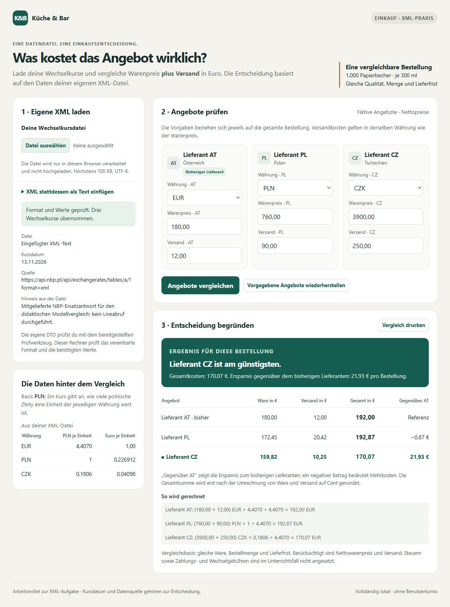

# Lieferantenangebote mit XML vergleichen

Verfasser: **Didaktisches Modell – Profil guter Schüler**\
Datum: **13.11.2026**

Dies ist eine KI-erstellte Modellsimulation, keine beobachtete Schülerleistung. Die unten beschriebenen Datei- und CLI-Prüfungen wurden tatsächlich ausgeführt; Unterrichtsdauer und Arbeitsverhalten stehen als Annahmen in `VERLAUF.md`.

## 1. Einführung

Für 1.000 Papierbecher sollen Angebote aus Österreich, Polen und Tschechien verglichen werden. Dazu müssen Warenpreis und Versand in eine gemeinsame Währung umgerechnet werden.

## 2. Projektbeschreibung

Die benötigten Kurse wurden aus der mitgelieferten NBP-Antwort in eine eigene XML-Datei übertragen. Die eigene DTD prüft ihre Struktur; aus den Kursen wurden die Gesamtkosten und eine Empfehlung berechnet.

## 3. Theorie

1. **Wurzelelement:** Das einzige äußerste Element, das alle anderen Elemente umfasst. Hier: `wechselkurse`.
2. **Element, Attribut und Text:** Elementname `kurs`; Attributname `waehrung`; Attributwert `EUR`; Textinhalt `4.4070`.
3. **Zweck einer DTD:** Sie legt die erlaubte Struktur mit Elementen und Attributen fest. Meine Regel `(quelle, kurs+, hinweis?)` verlangt zuerst genau eine Quelle, danach mindestens einen Kurs und zuletzt höchstens einen Hinweis.
4. **Häufigkeit und Reihenfolge:** `kurs+` bedeutet ein oder mehrere Kurse, `hinweis?` keinen oder einen Hinweis. Kein Kurs ist deshalb nicht erlaubt; kein Hinweis ist erlaubt. Ein vorhandener Hinweis muss wegen der mit Kommas festgelegten Reihenfolge nach den Kursen stehen.
5. **Pflichtattribut und erlaubte Werte:** `#REQUIRED` verlangt das Attribut `waehrung`, und `(EUR|CZK|PLN)` beschränkt seinen Wert auf diese drei Möglichkeiten. Ohne das Attribut oder mit `waehrung="USD"` ist der Kurs nach meiner DTD ungültig.
6. **Wohlgeformt oder DTD-gültig:** Kopie A ist wegen der verschiedenen öffnenden und schließenden Tagnamen nicht wohlgeformt und damit auch nicht DTD-gültig. Kopie B ist wohlgeformt, aber wegen der fehlenden Pflichtquelle DTD-ungültig. Wohlgeformtheit betrifft die XML-Syntax; DTD-Gültigkeit zusätzlich die vereinbarte Struktur.
7. **Grenze der DTD:** Ja, `-4.4070` kann als Text wohlgeformt und DTD-gültig sein, weil `#PCDATA` keine positive Zahl verlangt. Die Anwendung muss zusätzlich prüfen, ob der Text eine zulässige Zahl größer als null ist; deshalb lehnt der Rechner den negativen Kurs ab.

## 4. Arbeitsschritte

Anfrage-URL: `https://api.nbp.pl/api/exchangerates/tables/a/?format=xml`\
Kursdatum aus `EffectiveDate`: **2026-11-13**\
Verwendet: die mitgelieferte Datei `ersatzdaten/nbp-2026-11-13.xml`, unverändert als `quellen/nbp-antwort.xml` kopiert. Für die Modellsimulation wurde diese Datenbasis vorgegeben. Ein Liveabruf wurde nicht durchgeführt und ein Dienstausfall nicht festgestellt; eine eigene Abrufzeit gibt es daher nicht.

Übernommene Werte in PLN je einer Währungseinheit: **EUR 4.4070; CZK 0.1806; PLN 1**. Die zwei `Mid`-Werte und das Datum stammen aus derselben Antwort. EUR- und CZK-Werte wurden anhand der jeweiligen `Code`-Elemente zugeordnet.

`arbeit/wechselkurse.xml` enthält Quelle, drei Kurse und einen abschließenden Hinweis. `arbeit/wechselkurse.dtd` beschreibt alle vier Elementtypen; die Attribute sind erforderlich und `basis` ist auf PLN beschränkt. Die DTD wird separat übergeben, deshalb enthält mein XML keinen DOCTYPE.

| Eingabe und Prüfung | Erwartung | Tatsächliches Ergebnis und Erklärung |
| --- | --- | --- |
| Korrektes XML: XML und DTD | beide erfolgreich | `WOHLGEFORMT`, Exit 0; `DTD-GÜLTIG`, Exit 0. Syntax und deklarierte Struktur passen. |
| Syntaxfehler-Kopie: XML | Fehler | `XML-FEHLER`, Exit 1, Zeile 4: `kurs` und `kurs_falsch` passen nicht zusammen. |
| Strukturfehler-Kopie: XML und DTD | wohlgeformt, DTD-ungültig | `WOHLGEFORMT`, Exit 0; `DTD-UNGÜLTIG`, Exit 1. Das vollständige Element `quelle` fehlt. |

Die vollständigen Befehle, Originalausgaben und Exitcodes stehen in `nachweise/cli-pruefungen.json`.

**Manueller Rechencheck:** PL: `(760 + 90) × 1 ÷ 4.4070 = 192.8749716… EUR`, also **192,87 EUR**. CZ: `(3900 + 250) × 0.1806 ÷ 4.4070 = 749.49 ÷ 4.4070 = 170.0680735… EUR`, also **170,07 EUR**. Erst die Endergebnisse wurden auf Cent gerundet; AT kostet `180 + 12 = 192,00 EUR`.

**Vergleichsansicht:** Die koordinierende QA hat den tatsächlichen Inhalt meiner finalen XML-Datei über das vorhandene XML-Textfeld in den Rechner importiert. Der Dateidialog erreichte einen Timeout; ein erfolgreicher Dateiimport über diesen Dialog wird daher nicht behauptet. Der Rechner bestätigte die Format- und Werteprüfung und zeigte AT **192,00 EUR**, PL **192,87 EUR**, CZ **170,07 EUR** sowie **21,93 EUR** Ersparnis für CZ gegenüber AT. Diese Browserwerte stimmen mit dem manuellen Rechencheck überein. Der tatsächliche Nachweis ist in `../browser-results.json` protokolliert; die DTD-Prüfung bleibt der separate CLI-Nachweis.

## 5. Zusammenfassung

Ich empfehle Lieferant CZ mit Gesamtkosten von **170,07 EUR** für die vorgegebene Bestellung. Gegenüber AT mit **192,00 EUR** ergibt das eine Ersparnis von **21,93 EUR**; PL liegt mit **192,87 EUR** um **0,87 EUR** über AT. Die Empfehlung gilt für die vorgegebenen gleichen Mengen, Qualität und Lieferfrist sowie die im Auftrag berücksichtigten Nettopreise und Versandkosten.

## 6. Quellen

- Narodowy Bank Polski, XML-Kurstabelle A, Nr. `221/A/NBP/2026`, Kursdatum 13.11.2026; mitgelieferte Originalantwort. Herkunfts-URL: `https://api.nbp.pl/api/exchangerates/tables/a/?format=xml`; lokale Datei am 13.11.2026 gelesen, kein eigener Onlineabruf.
- Aufgabenmaterial, Version `20261113v2`: `TASK.md`, `README.md`, `DATENVERTRAG.md`, `DTD-HILFE.md` und Dokumentationsvorlage, lokal am 13.11.2026 gelesen.

KI-Unterstützung: Codex erstellte diese ausdrücklich gekennzeichnete didaktische Modellsimulation einschließlich XML, DTD und Antworten und führte die dokumentierten CLI-Prüfungen aus. Es wird kein realer Schüler und keine tatsächliche Unterrichtsbeobachtung dargestellt.
