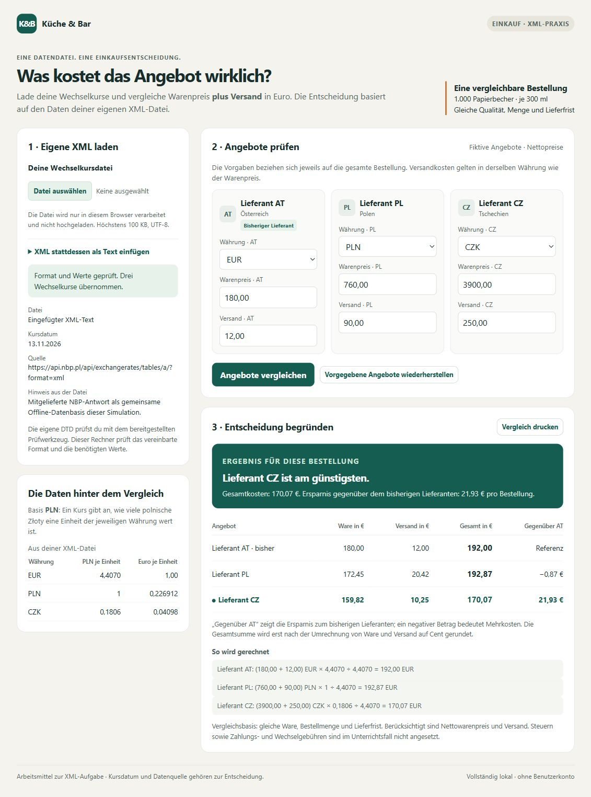

# Lieferantenangebote mit XML vergleichen

Verfasser: **Didaktisches Modell – mittleres Profil** · Datum: **13.11.2026**

> Simulierte Schülerarbeit, keine Beobachtung eines realen Lernenden. Die Antworten und der Lernverlauf sind modelliert; die protokollierten XML-/DTD-Prüfungen wurden tatsächlich ausgeführt.

## 1. Einführung

Das Bistro braucht 1.000 gleiche Papierbecher und möchte Angebote aus Österreich, Polen und Tschechien vergleichen. Die Preise sind erst mit Wechselkursen und Versandkosten sinnvoll vergleichbar.

## 2. Projektbeschreibung

Aus der bereitgestellten NBP-XML-Antwort wurden die Kurse gesucht und in ein eigenes XML übertragen. Die Struktur wurde mit einer selbst erstellten DTD geprüft; anschließend wurden die XML-Daten im fertigen Rechner verwendet und die Eurokosten für eine Empfehlung verglichen.

## 3. Theorie

1. **Wurzelelement:** Das äußerste Element, in dem die anderen Elemente stehen. Meine Datei hat `wechselkurse` als Wurzelelement.
2. **Element, Attribut und Text:** Elementname `kurs`; Attributname `waehrung`; Attributwert `EUR`; Textinhalt `4.4070`.
3. **Zweck einer DTD:** Sie legt die erlaubte Struktur mit Elementen und Attributen fest. In meiner DTD muss genau eine `quelle` vor den Kursen stehen.
4. **Häufigkeit und Reihenfolge:** `kurs+` bedeutet einen oder mehrere Kurse; kein Kurs ist also nicht erlaubt. `hinweis?` bedeutet keinen oder einen Hinweis. Der Hinweis darf nicht vor den Kursen stehen, weil die Kommas die Reihenfolge Quelle, Kurse, Hinweis festlegen.
5. **Pflichtattribut und erlaubte Werte:** `#REQUIRED` verlangt das Attribut `waehrung`. `(EUR|CZK|PLN)` erlaubt nur diese drei Werte. Ohne Attribut oder mit `USD` ist der Kurs nach dieser DTD ungültig.
6. **Wohlgeformt oder DTD-gültig:** Kopie A ist nicht wohlgeformt, weil Anfangs- und Endtag verschieden heißen, und kann daher auch nicht DTD-gültig sein. Kopie B bleibt wohlgeformt, ist aber DTD-ungültig, weil die vorgeschriebene Quelle fehlt. Wohlgeformtheit prüft die XML-Schreibregeln; die DTD prüft zusätzlich die vereinbarte Struktur.
7. **Grenze der DTD:** Ja, `-4.4070` kann wohlgeformt und DTD-gültig sein, weil `#PCDATA` Text zulässt und keine positive Zahl verlangt. Die Anwendung muss zusätzlich prüfen, dass der Kurs eine Zahl größer als null ist.

## 4. Arbeitsschritte

Anfrage-URL: `https://api.nbp.pl/api/exchangerates/tables/a/?format=xml` · Kursdatum: **2026-11-13**.

Verwendet wurde die unverändert kopierte mitgelieferte Antwort `ersatzdaten/nbp-2026-11-13.xml` als gemeinsame Offline-Datenbasis des Modellvergleichs. Es fand kein Liveabruf statt; ein Dienstausfall wird nicht behauptet. Die Kursrichtung ist PLN je einer Währungseinheit: **EUR 4.4070, CZK 0.1806, PLN 1**.

In `arbeit/wechselkurse.xml` stehen die Quelle und drei Kurse innerhalb von `wechselkurse`; am Ende steht ein Hinweis zur Offline-Basis. In der ersten DTD hatte ich versehentlich nur einen Kurs erlaubt. Nach der Fehlermeldung und dem Nachlesen in der DTD-Hilfe wurde die Regel zu `(quelle, kurs+, hinweis?)` korrigiert.

| Eingabe und Prüfung | Erwartung | Tatsächliches Ergebnis und Erklärung |
| --- | --- | --- |
| Korrektes XML: XML und DTD | beide erfolgreich | XML: `WOHLGEFORMT`, Exit 0; DTD: `DTD-GÜLTIG`, Exit 0. Die Datei passt zu den deklarierten Regeln. |
| Syntaxfehler-Kopie: XML | Fehler | `XML-FEHLER`, Exit 1, Zeile 4: `kurs` und `kurs_falsch` passen nicht zusammen. |
| Strukturfehler-Kopie: XML und DTD | wohlgeformt, DTD-ungültig | XML: `WOHLGEFORMT`, Exit 0; DTD: `DTD-UNGÜLTIG`, Exit 1. Die vollständige Quelle fehlt. |

Die unveränderten Ausgaben, Fehlerausgaben und Rückgabecodes stehen in `pruefungen/03-final-xml` bis `07-struktur-dtd` mit den Endungen `.json`, `.stdout.txt`, `.stderr.txt` und `.exitcode.txt`.

**Manueller Rechencheck CZ:** `(3900 + 250) × 0.1806 ÷ 4.4070 = 749.49 ÷ 4.4070 = 170.0680735… EUR`. Erst am Ende gerundet: **170,07 EUR**. Zum Vergleich: AT `180 + 12 = 192,00 EUR`; PL `850 ÷ 4.4070 = 192.8749716…`, gerundet **192,87 EUR**.

**Echter Browsernachweis:** Der Dateidialog lieferte einen Timeout; danach wurde der tatsächliche Inhalt von `arbeit/wechselkurse.xml` über das vorhandene XML-Textfeld eingelesen. Der Rechner bestätigte „Format und Werte geprüft. Drei Wechselkurse übernommen.“ und zeigte AT 192,00 EUR, PL 192,87 EUR, CZ 170,07 EUR sowie 21,93 EUR Ersparnis für CZ. Diese Anzeige stimmt mit der eigenen Rechnung überein; eine erfolgreiche Dateiauswahl wird nicht behauptet.

## 5. Zusammenfassung

Ich empfehle CZ mit Gesamtkosten von **170,07 EUR** für die 1.000 Becher. Gegenüber AT mit 192,00 EUR werden **21,93 EUR** gespart; PL liegt mit 192,87 EUR etwas über AT. Qualität und Lieferfrist sind gleich vorgegeben, deshalb entscheidet hier der Preis einschließlich Versand.

## 6. Quellen

- Bereitgestellte Angabe `TASK.md`, Datenvertrag, README und DTD-Hilfe, Bearbeitungsstand 13.11.2026.
- Narodowy Bank Polski, bereitgestellte XML-Antwort vom 13.11.2026, Tabelle 221/A/NBP/2026; Anfrage-URL siehe oben. Keine zusätzliche Website-Recherche und kein Liveabruf.

KI-Unterstützung: Diese gesamte didaktische Simulation wurde mit ChatGPT/Codex erstellt. Die modellierte Schülerin bzw. der modellierte Schüler verwendet die bereitgestellten Hilfen und einen kurzen Lehrkraftimpuls zu Frage 7; dies ist keine reale Unterrichtsbeobachtung.