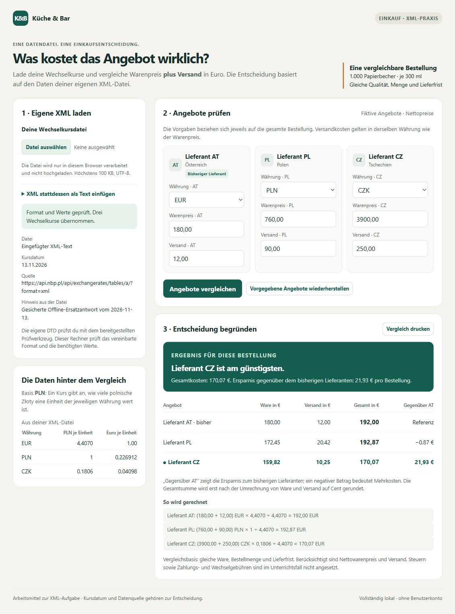

# Lieferantenangebote mit XML vergleichen

**DIDAKTISCHES MODELL – Schülerantworten des Profils „schwach“, keine reale Person.** Die Antworten und Bearbeitungszeiten sind modelliert. Die protokollierten XML-/DTD-Prüfungen und der Browsernachweis wurden tatsächlich ausgeführt. Datum: 13.11.2026.

## 1. Einführung

Das Bistro will 1.000 Papierbecher einkaufen. Ich soll herausfinden, welches Angebot mit Versand nach dem Umrechnen am günstigsten ist.

## 2. Projektbeschreibung

Die gesicherte Antwort der Nationalbank wurde als Quelle verwendet. Daraus wurden die Kurse in eine eigene XML-Datei eingetragen, mit einer eigenen DTD geprüft und im bereitgestellten Rechner zum Vergleichen benutzt.

## 3. Theorie – meine Antworten nach Überarbeitung

1. **Wurzelelement:** Das äußerste Element, in dem die anderen Elemente stehen. Bei mir heißt es `wechselkurse`.
2. **Element, Attribut und Text:** Elementname: `kurs`. Attributname: `waehrung`. Attributwert: `EUR`. Textinhalt: `4.4070`.
3. **Zweck der DTD:** Sie beschreibt, welche Elemente und Attribute in der Datei vorkommen dürfen und wie sie angeordnet sind. Bei mir muss zuerst `quelle` kommen und danach kommen die Kurse.
4. **Häufigkeit und Reihenfolge:** `kurs+` bedeutet mindestens einen Kurs, `hinweis?` keinen oder einen Hinweis. Kein Kurs ist nicht erlaubt, kein Hinweis ist erlaubt. Ein Hinweis vor den Kursen ist nicht erlaubt, weil in der Klammer erst `quelle`, dann `kurs+` und am Ende `hinweis?` steht.
5. **Pflichtattribut und Werte:** `#REQUIRED` heißt, dass `waehrung` angegeben werden muss. `(EUR|CZK|PLN)` erlaubt nur diese drei Werte. Ohne das Attribut oder mit `USD` wäre der Kurs nach meiner DTD ungültig.
6. **Wohlgeformt oder gültig:** A ist nicht wohlgeformt, weil der Endtag nicht passt, und damit auch nicht DTD-gültig. B ist wohlgeformt, aber nicht DTD-gültig, weil die vorgeschriebene Quelle fehlt. Wohlgeformt betrifft die XML-Schreibregeln; DTD-gültig bedeutet, dass auch die vereinbarte Struktur passt.
7. **Grenze der DTD:** Ja, `-4.4070` kann wohlgeformt und DTD-gültig sein. In der DTD ist der Kurs Text; sie prüft hier nicht, ob er positiv ist. Der Rechner braucht zusätzlich die Regel, dass der Zahlenwert größer als null sein muss. Diese Antwort habe ich mithilfe des Datenvertrags formuliert.

## 4. Arbeitsschritte und Ergebnisse

Anfrage-URL: `https://api.nbp.pl/api/exchangerates/tables/a/?format=xml`.
Kursdatum aus `EffectiveDate`: **2026-11-13**. Übernommen: **EUR 4.4070**, **CZK 0.1806**, **PLN 1**; jeweils PLN pro einer Einheit der Währung.

Verwendet wurde die **gesicherte Offline-Ersatzantwort** aus dem Arbeitsmaterial, für alle Modellprofile dieselbe Datenlage. Sie wurde unverändert nach `quellen/nbp-antwort.xml` kopiert. In dieser Simulation gab es keinen Liveabruf und keinen festgestellten Dienstausfall; ein eigener Abrufzeitpunkt wird daher nicht angegeben.

In `arbeit/wechselkurse.xml` stehen `basis` und `datum` im Starttag. Zuerst kommt die Quelle, dann kommen drei Kurse mit dem Attribut `waehrung`, zuletzt mein Hinweis zur Offline-Datei. In `arbeit/wechselkurse.dtd` erlaubt `kurs+` mehrere Kurse. Anfangs hatte ich Attribute als eigene Elemente geschrieben und das Plus vergessen. Mit Datenvertrag, Syntaxhilfe und zwei kurzen Hinweisen konnte ich das berichtigen.

| Eingabe und Prüfung | Erwartung | Tatsächliches Ergebnis und Erklärung |
| --- | --- | --- |
| Korrektes XML: XML und DTD | beide erfolgreich | `WOHLGEFORMT` und `DTD-GÜLTIG`, beide Exitcode 0. Die Schreibweise und die erklärte Struktur passen. |
| Syntaxkopie: XML | Fehler | `XML-FEHLER`, Exitcode 1: `kurs` und `kurs_falsch` passen nicht zusammen. |
| Strukturkopie: XML und DTD | XML erfolgreich, DTD Fehler | XML Exitcode 0, DTD Exitcode 1. Die Datei lässt sich lesen, aber `quelle` fehlt. |

Alle vollständigen Ausgaben und Aufrufe stehen in `TOOLPROTOKOLL.md`.

Mein Rechencheck für CZ: `(3900 + 250) × 0.1806 ÷ 4.4070 = 749.49 ÷ 4.4070 = 170.0680735… EUR`, gerundet **170,07 EUR**. Für AT sind es `180 + 12 = 192,00 EUR`. Für PL ergeben sich `850 ÷ 4.4070 = 192,8749716… EUR`, gerundet **192,87 EUR**.

**Rechnernachweis:** Der Inhalt der korrekten XML-Datei wurde über das vorhandene Textfeld des Rechners importiert, nachdem der Dateidialog in der Prüfumgebung einen Timeout lieferte. Der Rechner bestätigte „Format und Werte geprüft. Drei Wechselkurse übernommen.“ Die sichtbaren Beträge sind AT **192,00 EUR**, PL **192,87 EUR**, CZ **170,07 EUR**; Ersparnis CZ gegenüber AT **21,93 EUR**. Die Browserbedienung und Aufnahme erfolgten durch den koordinierenden Prüflauf; der Screenshot wurde in dieser Simulation zusätzlich angesehen.

## 5. Zusammenfassung

Ich empfehle CZ mit 170,07 EUR inklusive Versand. Gegenüber AT mit 192,00 EUR werden 21,93 EUR gespart; Qualität und Lieferfrist sind laut Aufgabe gleich. Der Rechner bestätigt meine Rechnung.

## 6. Quellen und Unterstützung

NBP: gesicherte XML-Antwort `ersatzdaten/nbp-2026-11-13.xml` aus dem Arbeitsmaterial, Tabelle 221/A/NBP/2026; Anfrage-URL oben, kein eigener Liveabruf. Unterrichtsmaterial: TASK.md, README.md, DATENVERTRAG.md, DTD-HILFE.md und Dokumentationsvorlage; keine weiteren Webseiten gelesen.

KI-Unterstützung: Diese gesamte Schülerabgabe ist durch Codex als didaktisches Modell erzeugt. Sie dokumentiert keine tatsächliche Schülerleistung. Zwei modellierte Lehrkraftimpulse sind im VERLAUF wörtlich ausgewiesen; echte Toolresultate sind getrennt protokolliert.
